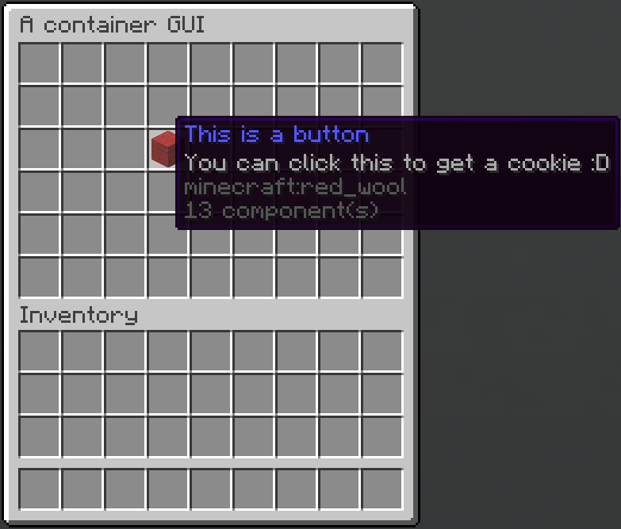
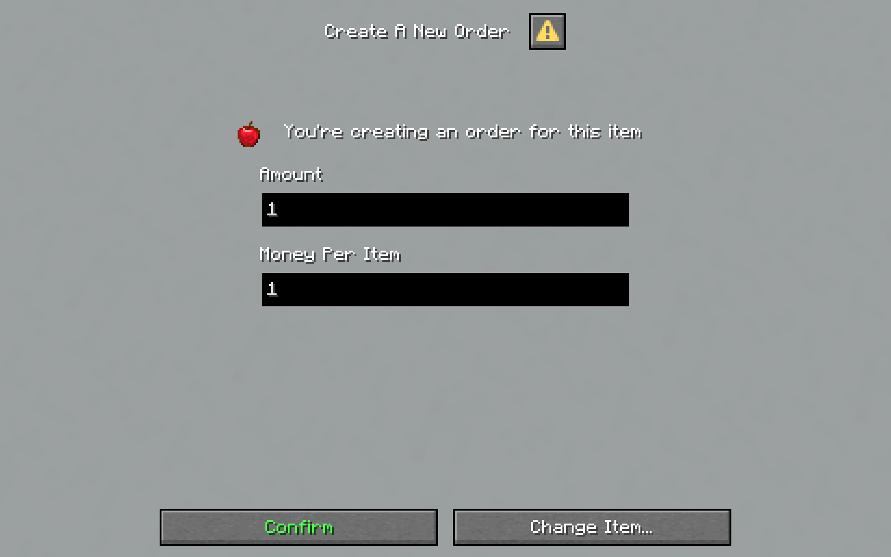
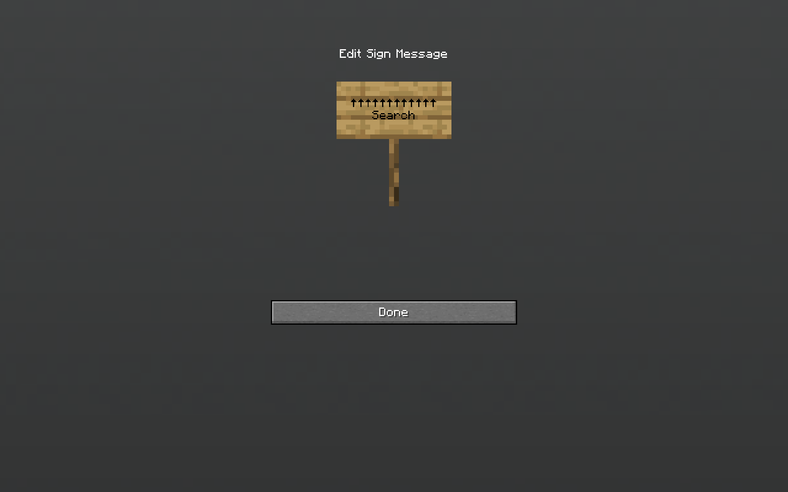

Orderium has a GUI system to make interactions with orders easy for your players.

# GUI Types

There are a few types of GUIs in this system. This section covers all of them and provides examples of how they look.

## Chest

Chest (or also (mis)labeled as "container") is the most common GUI type in the plugin, and probably also is the most well-known one in the community.

In Minecraft, a container GUI consists of:

- Title: A text component at the top of the GUI;
- Size: A number determining the amount of slots in the GUI. This number must be a multiple of 9, between 9 and 54 (inclusive);
- Slots: A list of items.

For Orderium,

- "size" is also known as "rows", which is a number between 1 and 6 (inclusive) determining the amount of rows in the container. Conversion: `size = rows * 9`.
- A "slot" is also known as "button", which is an item like a normal slot, but it can perform certain actions upon clicking or have data dependent on the context of the GUI.

<details>
  <summary>In-game Example</summary>

  
</details>

### Framework

Orderium implements a framework for creating and using chest container GUIs.

This framework wraps around Bukkit's `Inventory`, providing actions for slots, cancel regular clicks and other utilities.

Classes related to the framework live under the `me.karven.orderium.guiframework` package.

#### Using the framework

This is an example of using the framework to create a new GUI, add buttons and certain actions when triggering events.

The following code should open a GUI to the specified player. The GUI has 27 slots, with a diamond at the center slot.

Clicking that item gives the player a cookie. The player cannot take the diamond out of the GUI.

Closing the GUI sends a message to the player: "You closed the GUI :(".

```java
final int CENTER_SLOT = 13;
Player player = ...;
InventoryGUI gui = new InventoryGUI(3, Component.text("My beloved GUI"), true);

ItemStack item = ItemStack.of(Material.DIAMOND);
item.lore(List.of(Component.text("Click me for a cookie :D!")));

InventoryItem button = new InventoryItem(item, clickEvent -> {
    clickEvent.getPlayer().give(ItemStack.of(Material.COOKIE));
});

gui.addItem(button, CENTER_SLOT);

gui.setOnClose(closeEvent -> {
    closeEvent.getPlayer().sendRichMessage("You closed the GUI :(");
});

gui.open(player);
// You can also open the GUI to more players as you wish
```

#### Paginated GUI

The framework also contains a "paginated GUI" feature. The basic point of paginated GUI is to show a list of objects.

For example, in the main GUI, you can see a list of all active orders. This is a paginated GUI.

Each object in the list reserves a slot in the GUI.
If the list is longer than the number of slots available, paginated GUI creates a new page as the next page to display those objects.

Each object is required to have an "icon", which is an `ItemStack` so that the object can be displayed in the chest container.
The framework lets you perform certain actions when clicking on an object in a paginated GUI, similarly to standard GUIs.

A few differences between standard GUI and paginated GUI:
- Paginated GUI has a list of objects and display them accordingly to what slots you allow, as well as actions for clicking icons of the objects.
- Each paginated GUI can only be shown to one player, whereas you can show one standard GUI to multiple players.
- Implementation of a standard GUI is simply an object, whereas for paginated GUI, you would have to create a class to extend the paginated GUI abstract class.

## Dialog

Dialog is added to Minecraft in 1.21.6. It provides many components to let servers build intuitive GUIs.

Due to the complexity of dialogs, this page cannot cover all of its feature. In case you want to, check out [this page](https://minecraft.wiki/w/Dialog) from the minecraft.wiki community.

<details>
  <summary>In-game Example</summary>
  
</details>

## Sign

:::caution
Sign GUI is deprecated in favor of dialog GUI and will be removed in future releases of the plugin.
:::

<details>
  <summary>In-game Example</summary>
  
</details>
