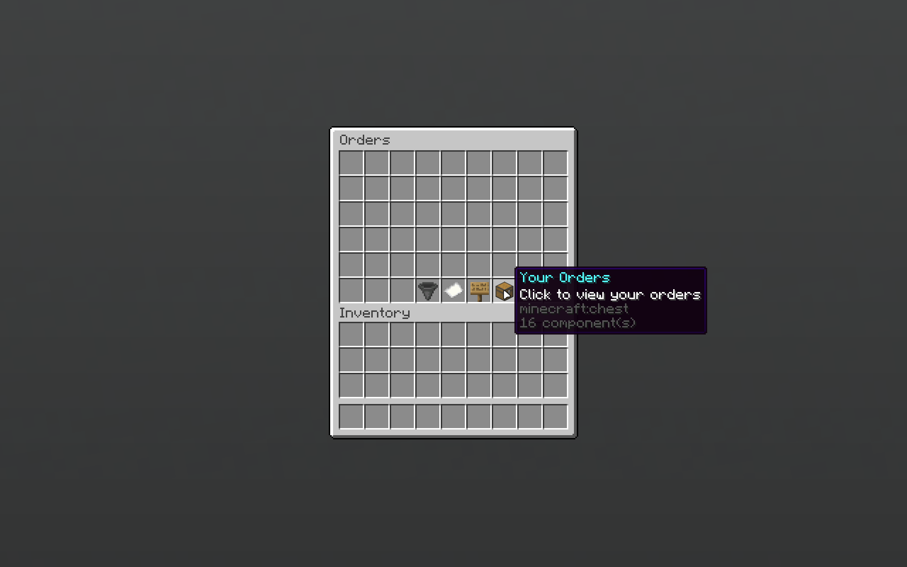
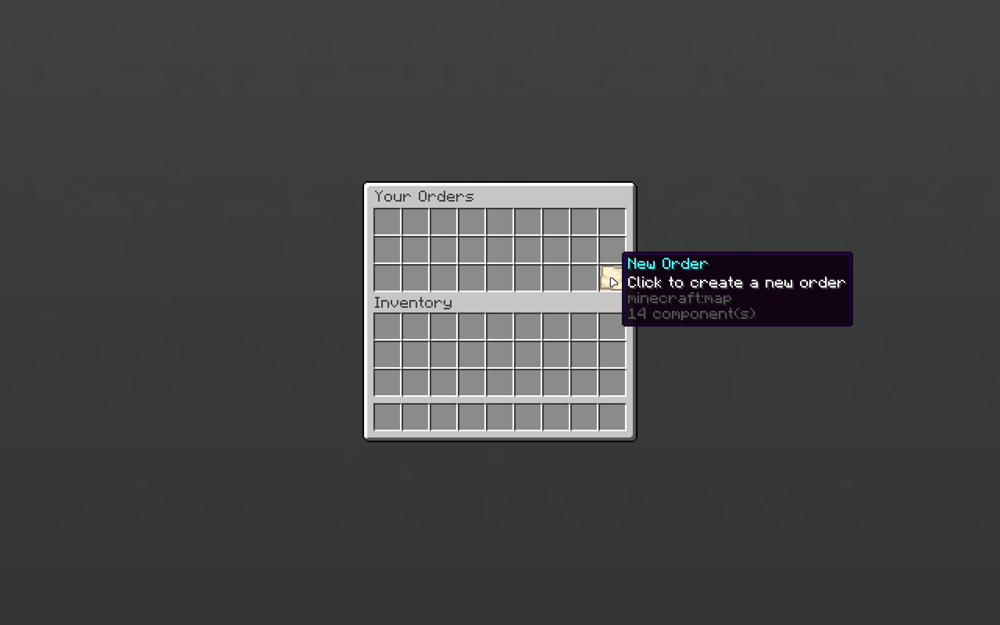
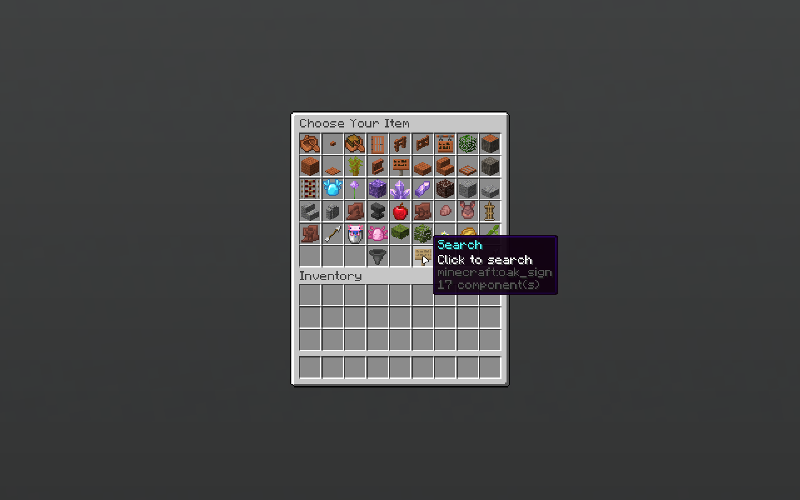
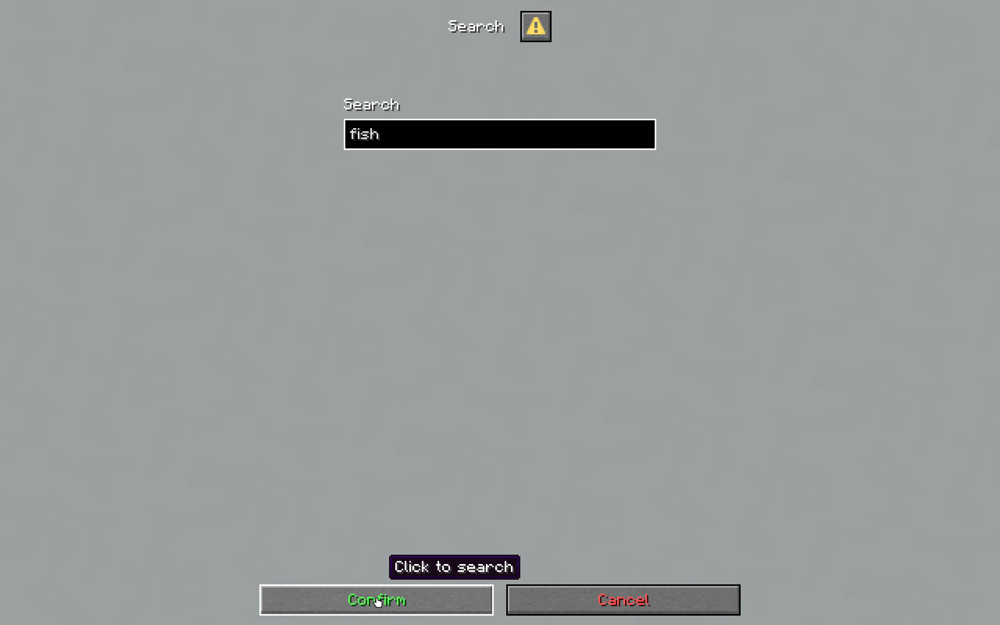
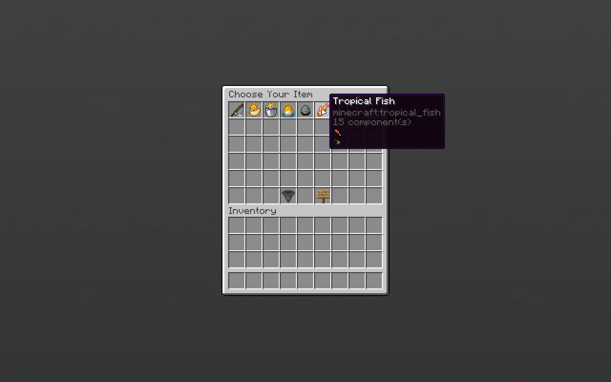
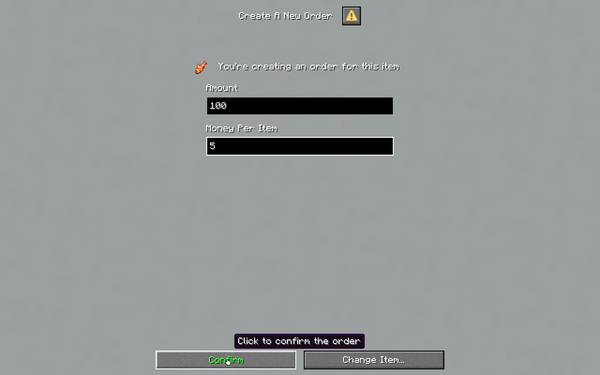

This page explains how you can use Orderium as a player on your server to get familiar with the system before you start configuring it as a server administrator.

This guide expects you to use the default configuration.

## Creating an order

To create an order, you first need to have money. Be sure you have some in your balance :).

Then, you can execute `/orders` to open the main GUI of the plugin. In this GUI, you can see all the orders that are available for you to deliver.

However, we want to create an order. To do so, click the "Your Orders" button at the bottom.
You can see your orders in this GUI. You will see a button to create an order. Click it to open the order creation GUI.

Another GUI will open where you can select the item you want to order. You can use the arrow buttons to navigate through the pages of items.
You can also search for an item by clicking the "Search" button.
When you find the item you want, click it to select it.

Now a dialog will show up where you can select the amount of items you want to order. You can use the arrow buttons to change the amount.
When you are done, click the "Confirm" button to create the order.

  
In-game step-by-step guide

  
  Step 1. Execute the /order command

  
  Step 2. Click on "Your Orders"

  
  Step 3. Click on "New Order"

  
  Step 4. Optionally search for the item you want

  
  Step 5. Type in the search input and click "Confirm"

  
  Step 6. Select the item you want to order

  
  Step 7. Fill in the quantity and price for each item inputs, then "Confirm" to create your order

## Delivering items

Now that orders are created, you can start delivering items to orders of other players.

Open the main GUI by executing `/orders`. In here, you can choose an order to deliver, you can of course search for the one you want to deliver, just like choosing an item.

Simply click on the order you want to deliver. An empty GUI should open, you can then put your items in the GUI to deliver them.
Once you've done so, escape the GUI. A confirmation dialog should show up before you actually deliver the items.

