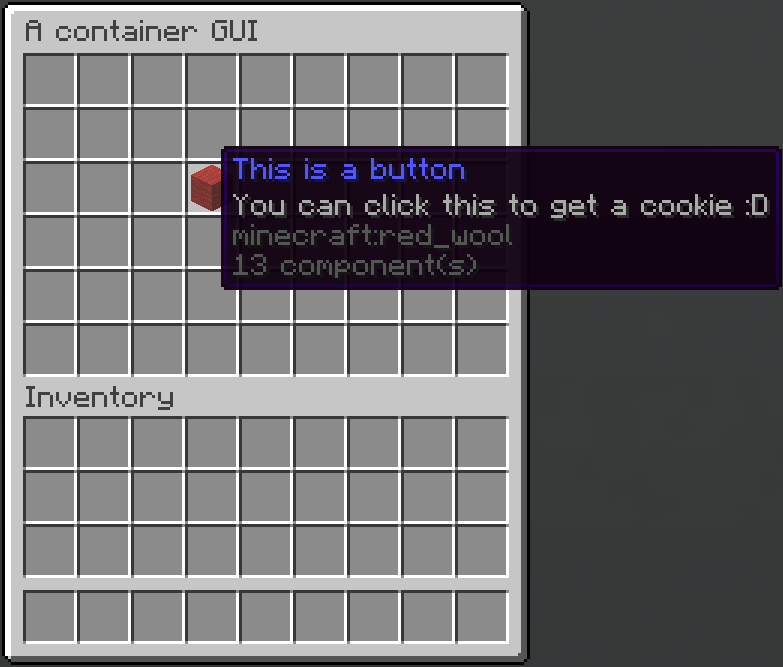
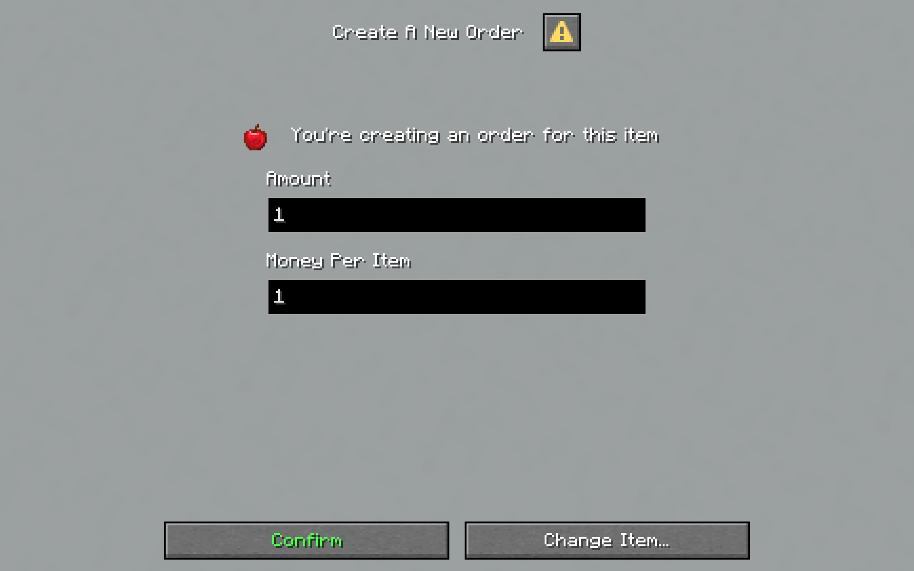

Orderium has a GUI system to make interactions with orders easy for your players.

# GUI Types

There are a few types of GUIs in this system. This section covers all of them and provides examples of how they look.

## Container

This is the most common GUI type in the plugin, and probably also is the most well-known one in the community.

In Minecraft, a container GUI consists of:

- Title: A text component at the top of the GUI;
- Size: A number determining the amount of slots in the GUI. This number must be a multiple of 9, between 9 and 54 (inclusive);
- Slots: A list of items.

For Orderium,

- "size" is also known as "rows", which is a number between 1 and 6 (inclusive) determining the amount of rows in the container. Conversion: `size = rows * 9`.
- A "slot" is also known as "button", which is an item like a normal slot, but it can perform certain actions upon clicking or have data dependent on the context of the GUI.

  
In-game Example

  

## Dialog

Dialog is added to Minecraft in 1.21.6. It provides many components to let servers build intuitive GUIs.

Due to the complexity of dialogs, this page cannot cover all of its feature. In case you want to, check out [this page](https://minecraft.wiki/w/Dialog) from the minecraft.wiki community.

Orderium currently only uses:
- Dialog format: `confirmation` and `multi_action`
- Body format: `plain_message` and `item`
- Input control format: `text` and `single_option`
- Action format: `dynamic/custom`

  
In-game Example

  

## Sign

:::caution
Sign GUI is deprecated in favor of dialog GUI and will be removed in future releases of the plugin.
:::
